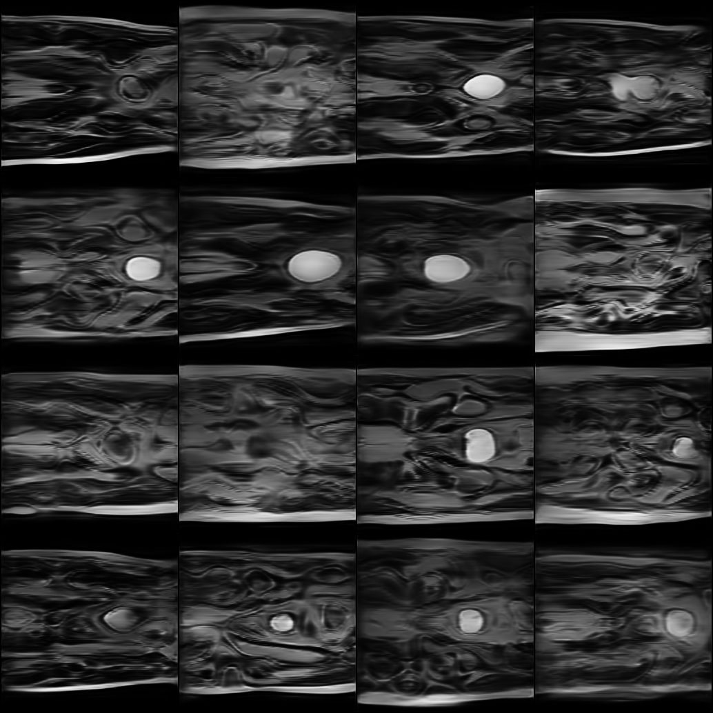
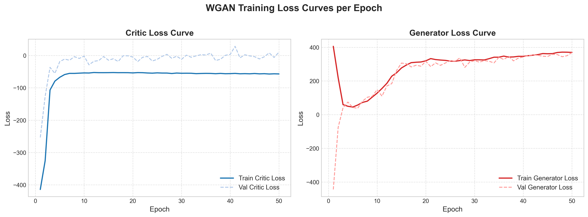
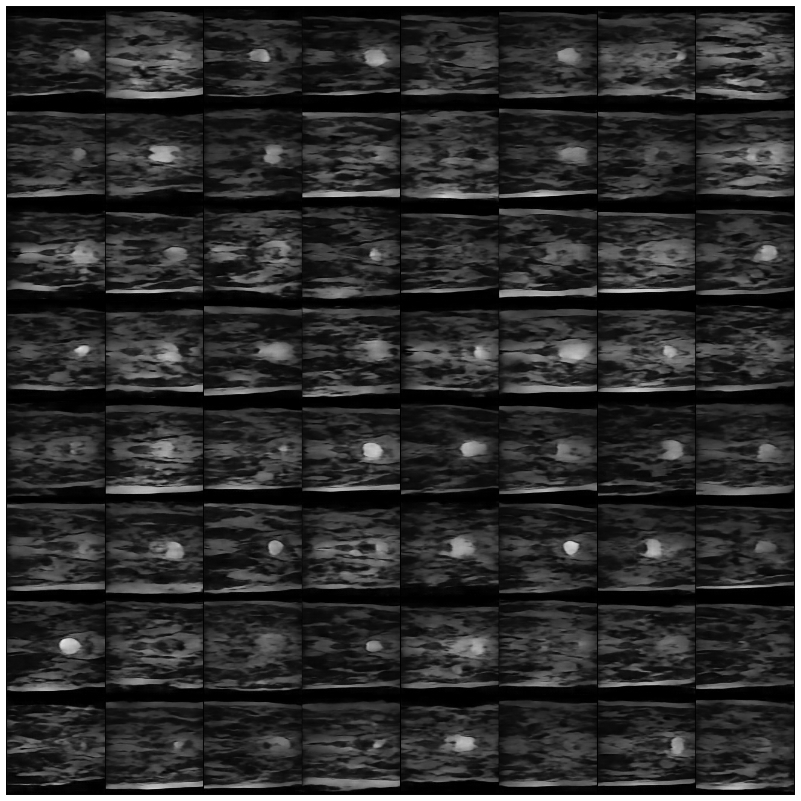
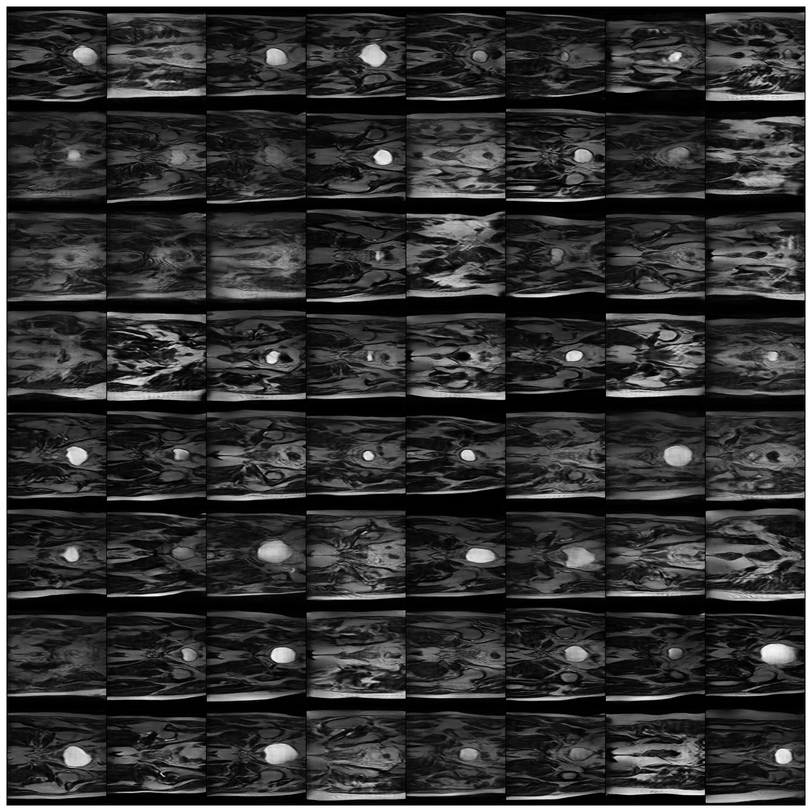
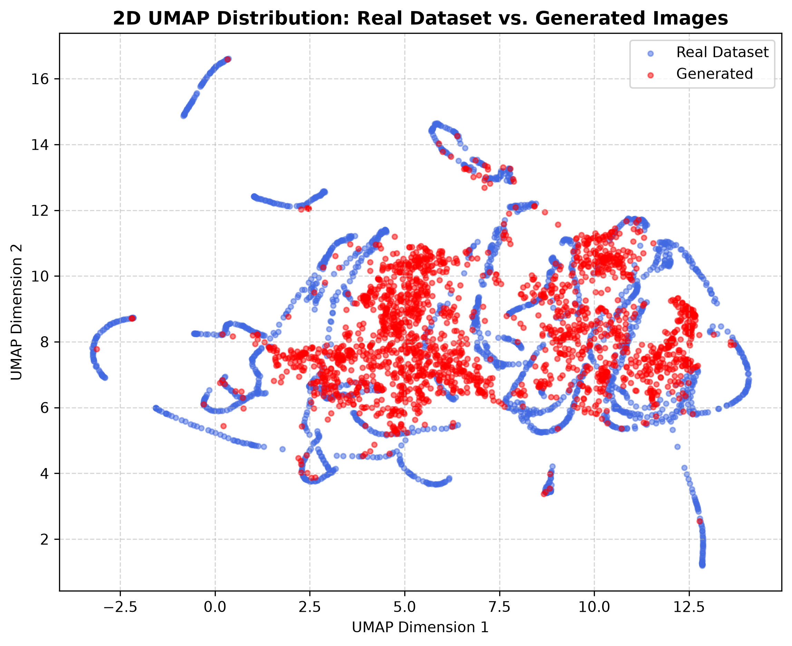
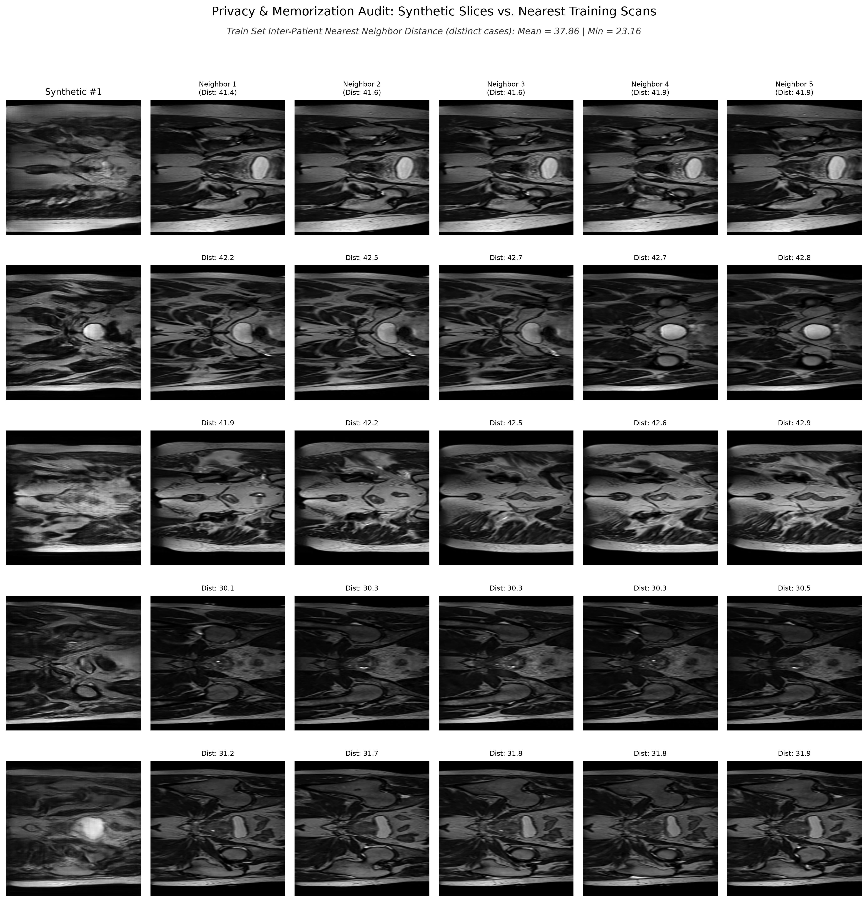
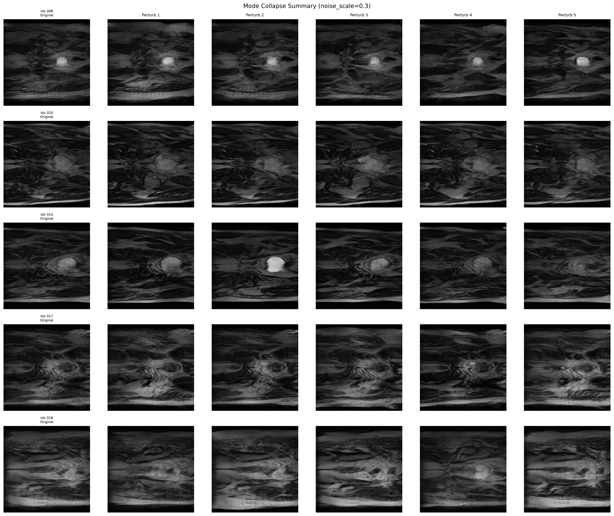

# Wasserstein GAN with Gradient Penalty (WGAN-GP) for Synthetic Medical Hip MRI Generation

This project implements and tests the WGAN-GP [1,2] algorithm for generating medical hip MRI images. The model should not only output high fidelity and diverse images, but also should output images that are different enough to not leak any identifiable data in the training set. This should address the lack of high-quality and anonymized image data in medical imaging research.

### How It Works
The architecture consists of two neural networks engaged in an adversarial minimax game: a **Generator** and a **Critic** (the WGAN equivalent of a discriminator). The Generator maps a low-dimensional random latent vector $z \sim \mathcal{N}(0, I)$ through resize-convolutions and residual blocks into a synthetic 2D MRI slice. Instead of classifying images as strictly real or fake with probabilities, the Critic outputs continuous real-valued scalar scores reflecting the Wasserstein distance (Earth Mover's Distance) between the real and synthetic data distributions. To maintain theoretical convergence and enforce the required 1-Lipschitz continuity condition without undesirable weight clipping artifacts, a **Gradient Penalty (GP)** term penalizes the norm of the Critic's gradients with respect to random interpolations between real and generated images. This formulation guarantees smooth, non-saturating gradients throughout training and mitigates classic GAN failure modes like mode collapse.

```mermaid
%%{init: {'themeVariables': { 'fontFamily': 'KaTeX_Main, STIX Two Math, "Cambria Math", "Times New Roman", serif' }}}%%
flowchart LR
    %% Nodes
    Noise["Noisy array<br/><span style='font-family:serif;font-style:italic;'>z</span> ~ <span style='font-family:serif;'>𝒩(0, <i>I</i>)</span>"]
    Gen["Generator<br/><span style='font-family:serif;font-style:italic;'>x</span><sub>fake</sub> = <span style='font-family:serif;font-style:italic;'>G</span>(<span style='font-family:serif;font-style:italic;'>z</span>)"]
    Real["real images<br/><span style='font-family:serif;font-style:italic;'>x</span><sub>real</sub> ~ ℙ<sub><i>r</i></sub>"]
    Fake["fake images<br/><span style='font-family:serif;font-style:italic;'>x</span><sub>fake</sub> ~ ℙ<sub><i>g</i></sub>"]
    Disc["Critic<br/><span style='font-family:serif;font-style:italic;'>D</span>(<span style='font-family:serif;font-style:italic;'>x</span>)"]
    Pred["Prediction<br/><span style='font-family:serif;font-style:italic;'>D</span>(<span style='font-family:serif;font-style:italic;'>x</span><sub>real</sub>), <span style='font-family:serif;font-style:italic;'>D</span>(<span style='font-family:serif;font-style:italic;'>x</span><sub>fake</sub>)"]
    GenLoss["Generator loss<br/><span style='font-family:serif;'>ℒ<sub><i>G</i></sub> = −𝔼[<i>D</i>(<i>x</i><sub>fake</sub>)]</span>"]
    DiscLoss["Critic loss<br/><span style='font-family:serif;'>ℒ<sub><i>D</i></sub> = 𝔼[<i>D</i>(<i>x</i><sub>fake</sub>)] −</br> 𝔼[<i>D</i>(<i>x</i><sub>real</sub>)] + <i>λ</i>·GP</span>"]

    %% Forward Connections
    Noise --> Gen
    Gen --> Fake
    Real --> Disc
    Fake --> Disc
    Disc --> Pred

    %% Loss & Feedback Connections
    Pred --> GenLoss
    Pred --> DiscLoss
    GenLoss -->|"Back<br/>propagation<br/>"| Gen
    DiscLoss -->|"Back<br/>propagation<br/>"| Disc

    %% Styling to match reference image layout & colors
    classDef noiseStyle fill:#d1d5db,stroke:#9ca3af,stroke-width:2px,color:#111827,font-weight:bold
    classDef genStyle fill:#d4a359,stroke:#b88636,stroke-width:2px,color:#ffffff,font-weight:bold,font-size:14px
    classDef realStyle fill:#d1e7dd,stroke:#badbcc,stroke-width:2px,color:#0f5132,font-weight:bold
    classDef fakeStyle fill:#e2e3e5,stroke:#d3d3d4,stroke-width:2px,color:#383d41,font-weight:bold
    classDef discStyle fill:#a855f7,stroke:#9333ea,stroke-width:2px,color:#ffffff,font-weight:bold,font-size:14px
    classDef predStyle fill:#ffffff,stroke:#16a34a,stroke-width:2.5px,color:#111827
    classDef genLossStyle fill:#8c6d23,stroke:#715617,stroke-width:2px,color:#ffffff,font-weight:bold,font-size:13px
    classDef discLossStyle fill:#6b21a8,stroke:#581c87,stroke-width:2px,color:#ffffff,font-weight:bold,font-size:13px

    class Noise noiseStyle
    class Gen genStyle
    class Real realStyle
    class Fake fakeStyle
    class Disc discStyle
    class Pred predStyle
    class GenLoss genLossStyle
    class DiscLoss discLossStyle
```




## Feasibility Review

### User Need, Scope & Acceptance Criteria
The intended users are downstream model developers who require a generative model to produce synthetic data for training and testing their models while preserving patient privacy.

The prototype will be a WGAN-GP model that can generate synthetic medical hip MRI images that are balanced in anatomical fidelity, distributional diversity, and privacy preservation.

The acceptance criteria for the prototype are:
1. FID score WGAN-GP < FID score VAE (quality/fidelity and diversity)
2. Euclidean distance to training set >= minimal distance of distinct patients in training set (privacy preservation)
3. peak VRAM usage < 16GB and training time < 8h on A100 GPU (performance)

### Model Choice & Course Concepts
The model choice is a Wasserstein GAN with Gradient Penalty (WGAN-GP) which is a generative adversarial network that uses the Wasserstein distance as a loss function and includes a gradient penalty to enforce the Lipschitz constraint. This model is chosen because it has been shown to produce high-quality images and is more stable during training compared to traditional GANs.

The model will be trained on a dataset of 2D hip MRI slices, with 11460 training, 540 test, and 660 validation images.

The original WGAN paper shows improved stability and convergence compared to traditional GANs, and the gradient penalty helps to enforce the Lipschitz constraint, which is important to prevent the discriminator gradient from exploding or vanishing. The WGAN-GP model has been shown to produce high-quality images [1] and is more stable during training compared to traditional GANs or DCGANs.

As a comparison baseline model, the regular Variational Autoencoder will be used and compared against quantitative benchmarks, FID scores, and visual quality.

### Preliminary Feasibility Evidence - Data Audit
The dataset has been audited for statistical properties, and the following summary statistics have been computed, indicating that the dataset is suitable for training a generative model. Mean and variance indicate a well distributed dataset, while skewness and kurtosis indicate that the dataset has a reasonable distribution of pixel intensities.
```
Mean                  : -0.6572
Variance              : 0.1244
Standard Deviation    : 0.3527
Skewness              : 1.4659
Excess Kurtosis       : 2.2119
```
The [UMAP projection](plots/real_mri_umap_audit.png) of 50 PCA components also shows that the dataset is well distributed and does not have any obvious clusters or outliers. The [top 10 outlier images](plots/mri_outliers_audit.png) have been identified and visually inspected, and they do not appear to be significantly different from the rest of the dataset.

### Risks, Budget & Fallback
Key risks:
1. Mode collapse or blurry anatomy -> enough epochs, model architecture research
2. Patient scan memorization (overfitting) -> audit nearest neighbor distance and latent distance

Training should be conducted as early as possible given the anticipated long training period on rangpur. A maximum GPU time of 10 hours is estimated.

## Running the code

### Environment & Installation
To reproduce the environment and install all necessary dependencies, clone the repository, navigate into the project directory, and install packages via `pip`:

```bash
# Optional: create and activate a virtual environment
python -m venv venv
source venv/bin/activate

# Install dependencies
pip install -r requirements.txt
```

### Training & Evaluation
In order to perform training on a Slurm GPU, use the `run_training.sh` script for the WGAN-GP or `run_training_vae.sh` for the VAE respectively. If not on Slurm, simply execute the `train.py` or `train_vae.py` files.

For a **WGAN training**, all model parameters from the 20th epoch on are saved in the `checkpoints/` folder. For determining the best checkpoint, inspect the samples for each epoch.

Set the path of the best checkpoint in `predict.py` and run the script either directly or via the `run_prediction.sh` bash script for Slurm. This prediction script generates sample images, calculates FID and SSIM scores, audits nearest neighbors, and plots a UMAP graph.

To deep dive into failed generations, inspect the samples generated from the `predict.py` in the `plots/WGAN-synth/` folder and set the indices and the respective model checkpoint in `inspect_selected.py`. 

For the **VAE training**, the best model parameters are automatically saved according to the lowest training loss, so no further action is required there.

All recent logs of WGAN and VAE training, including their evaluation with `predict.py` and `inspect_selected.py` are included in the `logs/` directory.

## Algorithm
The trained WGAN-GP generator takes 128-dimensional input vectors and produces 256x256 hip MRI images with a value range of [-1, 1].

Below is a grid of 16 images generated from random latent vectors by the trained WGAN generator.



As observed, the generated images are of reasonable quality and anatomical fidelity, although some still remain blurry and lack fine detail.

### Description
The final WGAN was trained on the provided train-validation-test split, already mentioned in the [feasibility review](#model-choice--course-concepts). It was trained for 50 epochs, as there was no further visual improvement observed when trained for more epochs. The training process furthermore includes a batch size of 64, a moderate learning rate of 1e-4, an Adam optimizer with beta1=0.0 and beta2=0.9, a gradient penalty coefficient of 10, and 5 critic iterations per generator step.

In order to choose the right parameter configuration, a sample grid of every epoch was generated and the image quality was assessed manually. This is due to the fact that losses in GANs do not always correlate with image quality. For the currently trained model and its test scripts, epoch 49 was chosen.

The training itself proves to be very stable, with a smooth training curve:



## Investigation of Open Research Dilemma

### Performance
A Structural Similarity Index Measure (SSIM) of 0.6 was not achieved and not further pursued because even generated images with good anatomical fidelity and reasonably clear edges had SSIM scores of around 0.3. I am also referring to [this discussion](https://edstem.org/au/courses/38242/discussion/3646803). As a substitute, the Fréchet Inception Distance (FID) was used as the primary metric to determine the quality and diversity of the generated images.

WGAN exhibits a clear lead (with a ~70% lower FID), suggesting that both fidelity and diversity are superior to the VAE. The corresponding output of `predict.py` can be found at [logs/predict.out](logs/predict.out). Surprisingly, the SSIM score is slightly higher for the VAE, but a look at the sample grids below shows that SSIM does not reflect visual quality in this application.

| Model | SSIM↑| FID↓ |
| ----- | ---- | --- |
| VAE | **0.2791** | 540.38 |
| WGAN-GP | 0.2650 | **165.07** |

As the FID score itself already highlights the generative superiority of the WGAN, the quality was also visually assessed by comparing samples.

As seen below, the VAE trained for 100 epochs still generates low-fidelity images that have no clear edges and are mostly blurry.



In direct comparison, the WGAN images are clearly more defined, with anatomical structures identifiable.



WGAN also provides a reasonable diversity of images, which becomes visible in a UMAP comparison with the training dataset. On the UMAP, clear groupings of the training images can be observed across almost the entire 2D plane in blue. The WGAN images in red, on the other hand, are less clustered but still cover a wide range on the 2D plane. It can be observed that the distribution of the WGAN images shows slightly less variance than the original dataset, but still spans a broad distribution.



Last but not least, a nearest neighbor audit was performed in order to check for potential privacy leaks. The minimal Euclidean distance of 500 generated samples to the training dataset was calculated and plotted in order to make a qualitative comparison. When visually comparing the image pairs, clear differences can be observed, suggesting that patient images have not been memorized. In addition, this minimal distance to the training dataset is still higher than the minimal distance between distinct patients within the training set, which further supports non-memorization.



### WGAN-GP Profiling
| Model | Training Peak VRAM | Inference Peak VRAM | Training Time (A100 GPU) | Inference Latency (A100 GPU)<br>1 element in 1000 element batch | Parameter Count |
| --- | --- | --- | --- | --- | --- |
| VAE | 1.52 GB | 0.77 GB | 1.04 h | 0.0147 ms | 18,191,937 |
| WGAN-GP | 9.20 GB | 2.35 GB | 2.57 h | 0.0343 ms | 27,336,066 |

### Error Autopsies
Out of 64 samples, five images with the worst perceived quality were inspected for further insight:

- Image 1: blurry lines, artifacts around the borders, wavy lines
- Image 2: wavy lines, uneven prostate shape, slightly blurry
- Image 3: no clear prostate borders
- Image 4: blurry lines, artifacts around the borders, undistinguishable shapes
- Image 5: overall blurry, overlapping wavy lines, no clear borders

In a first step, the critic was analysed and found to correctly identify 4 of the generations as obvious fakes and significantly poor samples (having a lower critic score than the mean of the batch).

The more significant observation, however, came from adding slight noise to the original latent vector. A summary of these modified latent vector generations can be observed in the plot below. Notably, all surrounding images appear visually similar to the original one, with a few showing a sharper and clearer version of the original generation. In addition, noticeably in rows 3 and 5, the surrounding generations also exhibit different modes.



With these observations, it can be concluded that the model does not experience a clear mode drop, but rather learned certain modes and still struggles with interpolation between them. The transition between these modes therefore appears blurry. This effect could potentially be mitigated through further training, allowing the generator to better structure its latent space.

The detailed inspection can be found in the `plots/WGAN_synth/selected_inspection/` directory, with the logs in the `logs/inspect_selected.out` file.

## Engineering Recommendation
Finally, the WGAN-GP prototype proves to provide reasonable anatomical fidelity, distributional diversity, and privacy preservation, matching the requirements for training downstream medical models. A significant qualitative superiority to the baseline VAE is observed in terms of visual quality and fidelity. Additionally, the model is highly performant with low inference VRAM and latency, satisfying all acceptance criteria.

Conversely, the generated WGAN images still lack a considerable amount of sharpness and realism when assessed manually. Furthermore, the FID remains relatively high, particularly when considering that state-of-the-art models like StyleGAN2 can achieve scores below 5 [3].

Therefore, as the image quality is still constrained, I recommend transitioning to a more sophisticated model architecture, such as StyleGAN2 or Stable Diffusion, to maximize image quality.

## Artificial Intelligence Usage Disclosure
I have utilized Google Gemini, opencode, and Github Copilot for this project. The AI tools assisted in generating code snippets for configuring model, train, prediction, plotting, and inspection scripts. Google Gemini also assisted in polishing grammar and language in the report and generating the script of the first figure. Every output code was precisely reviewed, tested and modified by me to ensure its correctness. All interpretations and conclusions drawn from the results are my own.

## References
[1]: Arjovsky, M. Wasserstein GAN (2017). [doi:10.48550](https://doi.org/10.48550/arXiv.1701.07875).

[2] Gulrajani, I. Improved Training of Wasserstein GANs (2017). [doi:10.48550](https://doi.org/10.48550/arXiv.1704.00028).

[3]: Karras, T. Analyzing and Improving the Image Quality of StyleGAN (2020). [doi:10.48550](https://doi.org/10.48550/arXiv.1912.04958).
